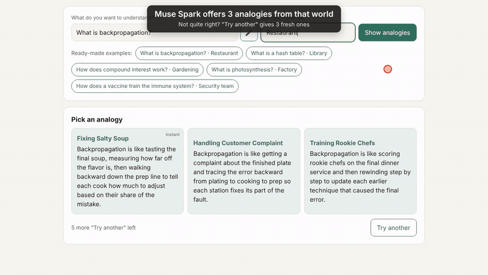
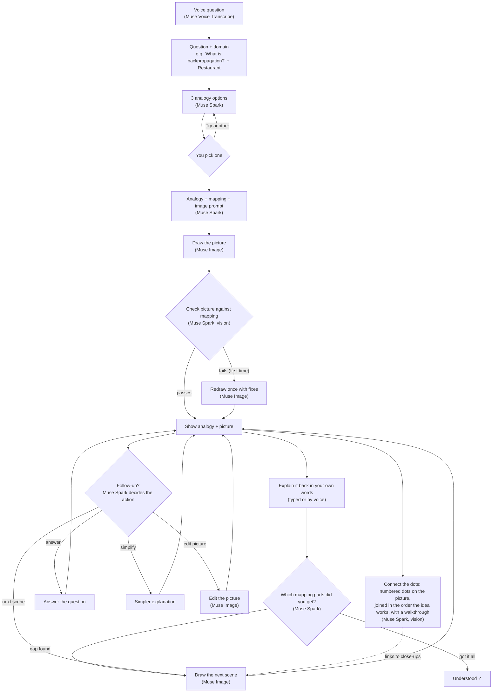

# Sketchbridge

Explain a hard idea with a picture analogy. Ask a question ("What is backpropagation?"), pick a world
you know ("Restaurant"), choose one of 3 analogies, and Sketchbridge writes it, draws it, and checks
its own drawing. Still confused? Say "I don't get it" and it simplifies, edits the picture, or draws the
next scene.

Everything runs on **Meta's hosted models** through Meta Model API. Nothing runs locally: no model
downloads, no GPU, no training.

[](https://drive.google.com/file/d/10cQzp1l6jx1U6yOEJzH_DPM6VP-6lxqg/view?usp=drive_link)

**▶ [Watch the full demo video with explanation](https://drive.google.com/file/d/10cQzp1l6jx1U6yOEJzH_DPM6VP-6lxqg/view?usp=drive_link)**

## How it works



While a picture is being made, a progress bar at the bottom of the page shows the real stage
(analogy, drawing, checking, redrawing) as the server reports it, with the seconds elapsed.

More detail is in [documentations/](documentations/): architecture, API facts, every decision, and a build log.

## Run it

You need Python 3.10 or newer (built and tested on 3.11) and a Meta Model API key from
[dev.meta.ai](https://dev.meta.ai/).

macOS / Linux:

```bash
python3.11 -m venv .venv
.venv/bin/pip install -r requirements.txt
cp .env.example .env          # then put your key after META_API_KEY=
.venv/bin/uvicorn app.main:app
```

Windows (PowerShell):

```bash
py -3.11 -m venv .venv
.venv\Scripts\python -m pip install -r requirements.txt
copy .env.example .env        # then put your key after META_API_KEY=
.venv\Scripts\uvicorn app.main:app
```

Open http://127.0.0.1:8000. The 5 **ready-made examples** load instantly from `cache/`, even without a key.

Other commands (use `.venv\Scripts\python` on Windows):

| Command | What it does |
| --- | --- |
| `.venv/bin/python -m app.smoke_test` | Calls each Meta function once to check your key works (about $0.015) |
| `.venv/bin/python -m app.run "backpropagation" --interest "cooking"` | The whole pipeline in the terminal |
| `.venv/bin/python -m app.build_demo` | Rebuilds any missing demo (`--only vaccine` for one, `--force` for all) |
| `.venv/bin/python -m pytest -q` | Offline tests, as run by CI (`pip install pytest` first; no key, no cost) |

## Deploy

Free hosting on **Render**, set up by `render.yaml`. GitHub Actions runs the tests on every push, and
Render deploys `main` only when they pass. An optional `ACCESS_CODE` keeps strangers from spending your
API credit; the ready-made examples stay free for everyone.
See [documentations/deployment.md](documentations/deployment.md).

## Cost

Each request prints its estimated cost; the page shows a running total.

| Action | Typical cost |
| --- | --- |
| 3 options | about $0.008 |
| Analogy + picture + check | about $0.025 (about $0.05 if it redraws) |
| Follow-up: answer | about $0.009 |
| Explain-it-back check | about $0.01 |
| Connect the dots | about $0.012 (free on the ready-made examples, and when replayed) |
| Follow-up: simplify / edit / next scene | about $0.02 |
| Voice question (a few seconds) | about $0.0002 |

Guards: at most 2 images per request, 5 "Try another" rounds per concept, 15 follow-ups per concept,
10 explain-it-back checks per concept, and 10 connect-the-dots per concept.

## Built during the hackathon

Everything in this repository was built new during the hackathon, **October 26 to November 4, 2026**
(commits from October 31 to November 3, 2026).

### Models used (all Meta-hosted, via Meta Model API)

| Model | ID | Used for | Price |
| --- | --- | --- | --- |
| Muse Spark 1.3 | `muse-spark-1.3` | options, analogy, image prompt, picture check, follow-ups | $1.25 in / $0.15 cached in / $4.25 out per 1M tokens |
| Muse Image 1.0 | `muse-image-1.0` | drawing and editing pictures | $0.01 per image |
| Muse Voice Transcribe | `muse-voice-transcribe-1.0` | voice questions | $0.18 per hour of audio |

No Contributor variants, open-weight models, or local models were used.

### Files

| File | What it is |
| --- | --- |
| `README.md` | This file |
| `.env.example` | Template for the key (`META_API_KEY=`) and the optional `ACCESS_CODE=` |
| `.gitignore` | Keeps `.env`, the virtual environment, and non-demo pictures out of git |
| `requirements.txt` | `fastapi`, `uvicorn`, `httpx` |
| `app/__init__.py` | Marks `app` as a Python package |
| `app/meta_client.py` | The only file that talks to Meta: `chat`, `chat_with_image`, `draw`, `transcribe`, with cost estimates |
| `app/pipeline.py` | Plain functions: options, analogy, draw, check, redraw once, follow-ups, explain-it-back check, and the cost guards |
| `app/run.py` | Command line: pick 1, 2, 3 or "a" for another set |
| `app/smoke_test.py` | Step 1 check that the key and each API call work |
| `app/main.py` | FastAPI server: `/options`, `/explain`, `/followup`, `/check`, `/transcribe`, `/image/{id}`, `/demos`, `/health`, and the access code |
| `app/build_demo.py` | Builds the 5 cached demos |
| `web/index.html` | The one-page app (no framework): question, domain, mic button, options, result card, explain-it-back check, follow-up chat |
| `render.yaml` | Render Blueprint: free plan, one worker, deploy only after CI passes |
| `.github/workflows/ci.yml` | GitHub Actions: runs the tests on every push and pull request |
| `documentations/media/demo.gif` | The animated preview at the top of this README (cut from the demo recording) |
| `tools/demo_video/` | Records the demo video from the real app (Playwright + ffmpeg) |
| `tests/test_app.py` | Offline tests (no key, no cost): routes, demos, validation, access code, explain-it-back, progress streaming, connect the dots |
| `cache/.gitkeep` | Keeps the `cache/` folder in git |
| `cache/demos.json` | The 5 demos: options, analogy, mapping, check result, a saved "simplify" answer, and connect-the-dots |
| `cache/demo-backpropagation.webp`, `cache/demo-backpropagation-simple.webp` | Backpropagation / Restaurant: picture and simpler picture |
| `cache/demo-hash-table.webp`, `cache/demo-hash-table-simple.webp` | Hash table / Library |
| `cache/demo-compound-interest.webp`, `cache/demo-compound-interest-simple.webp` | Compound interest / Gardening |
| `cache/demo-photosynthesis.webp`, `cache/demo-photosynthesis-simple.webp` | Photosynthesis / Factory |
| `cache/demo-vaccine.webp`, `cache/demo-vaccine-simple.webp` | Vaccines / Security team |
| `documentations/README.md` | Index of the docs |
| `documentations/architecture.md` | Layers, pipeline, follow-up actions, web routes |
| `documentations/meta-api.md` | Exact API details used, and where they came from |
| `documentations/decisions.md` | Every design decision and why |
| `documentations/steps.md` | Build log: what each step added, how it was tested, what it cost |

### Build steps

1. Meta client and smoke test
2. Pipeline on the command line
3. Web page, plus follow-ups (simplify, edit, next scene, ask)
4. Demo cache of 5 tested concepts
5. Voice questions with Muse Voice Transcribe
6. This README
7. Explain-it-back check: the learner explains the idea, Muse Spark grades each mapping part
8. Deployment on Render with GitHub Actions CI and an access code
9. Progress bar with live stages, and connect the dots
10. Light/dark toggle, a fix for slow replies (HTTP 502), and the demo video

API details came from Meta's official cookbook
([meta-models/meta-model-cookbook](https://github.com/meta-models/meta-model-cookbook)).
