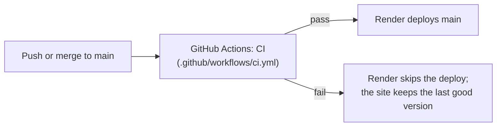

# Deployment

Sketchbridge is one FastAPI server, hosted on **Render's free plan**. No Docker is needed: Render runs
Python directly. All settings live in `render.yaml` at the repo root (a Render "Blueprint").

## One-time setup

1. render.com -> **New -> Blueprint** -> connect GitHub -> pick `Rasika-Deodhar/sketchbridge`.
2. Render reads `render.yaml` and asks for the two secrets:
   - `META_API_KEY`: your Meta Model API key.
   - `ACCESS_CODE`: a code visitors must type before anything that costs money (see below).
     Leave it empty only if you are happy for anyone with the link to spend your API credit.
3. Apply. The first build takes a few minutes; the app opens at `https://sketchbridge-xxxx.onrender.com`.

After that, every merge to `main` redeploys by itself, but only once the CI checks pass
(`autoDeployTrigger: checksPass`). Secrets stay in Render's dashboard and are never in git.

## What `render.yaml` sets

| Setting | Value | Why |
| --- | --- | --- |
| `plan` | `free` | |
| `buildCommand` | `pip install -r requirements.txt` | |
| `startCommand` | `uvicorn app.main:app --host 0.0.0.0 --port $PORT --workers 1` | one worker: the cost limits are counted in memory |
| `healthCheckPath` | `/health` | answers without calling Meta |
| `autoDeployTrigger` | `checksPass` | a commit that fails CI is not deployed |
| `PYTHON_VERSION` | `3.11.9` | the version the app was built and tested on |

## CI (GitHub Actions)

`.github/workflows/ci.yml` runs `python -m pytest -q` on every push and pull request. The tests in
`tests/test_app.py` use no API key and make no Meta calls, so they cost nothing. They check: the page,
`/health`, the 5 demos and their pictures; picture-name safety; input validation; the access code; and
that the explain-it-back check repairs a messy model reply.

Run them locally with `pip install pytest` and then `python -m pytest -q`.

## Access code

If `ACCESS_CODE` is set, every route that calls Meta (`/options`, `/explain`, `/followup`, `/check`,
`/transcribe`) needs the header `X-Access-Code`. The page asks for the code the first time it is
needed and remembers it in that browser. The page, `/health`, the ready-made examples and their
pictures stay open, so anyone can try the demos for free. Share the code only with people you want
to spend your credit, such as the judges.

Locally, leave `ACCESS_CODE` empty in `.env` to work without a code.

## Free plan limits

| | |
| --- | --- |
| Sleeps after | 15 minutes without visitors |
| Wake-up | about 1 minute on the first visit after sleeping; open the link yourself before a demo |
| Generated pictures | lost on sleep or restart; the 5 ready-made examples are in git, so they always work |
| Cost limits (per-concept caps) | reset on restart, because they are counted in memory |

The access code limits who can spend credit. It is not a spending cap: someone with the code can still
use the per-concept limits on many concepts. Set a budget limit on your Meta account as well.
